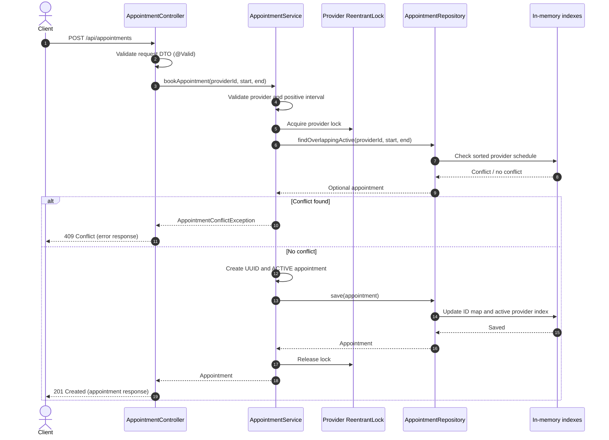

# Appointment Booking Service

A small Java and Spring Boot REST service that safely books and cancels appointments for service providers. The implementation was created for the **Charles Schwab AI-Assisted Engineering Assessment – Appointment B**.

The assessment asks for one bounded scheduling feature: prevent overlapping active appointments for the same provider, allow cancellation, use UTC timestamps, and provide focused automated tests and an honest record of AI assistance. This project deliberately does not attempt to build a complete scheduling product.

> **Current implementation:** Spring Boot REST API with an in-memory store. The automated test run recorded during development completed with **21 tests, 0 failures, 0 errors and 0 skipped**. Manual Postman verification should also be completed before final submission.

---

## 1. Problem and requirements

A provider must not be booked for two active appointments that overlap in time. The same time can be booked for a different provider. When an appointment is cancelled, it must stop blocking that time slot.

### Functional requirements

1. Create an appointment for a provider when the time interval is valid and has a positive duration.
2. Reject an appointment that overlaps another **active** appointment for the same provider.
3. Allow adjacent appointments. For example, `10:00–11:00` and `11:00–12:00` are both valid.
4. Do not treat appointments belonging to different providers as conflicts.
5. Allow a cancelled appointment's time slot to be booked again.
6. Return a clear result when an appointment does not exist or has already been cancelled.
7. Reject missing identifiers, invalid timestamps and non-positive durations without changing stored bookings.
8. Test normal and edge cases, including simultaneous booking attempts.
9. Record where AI helped, how suggestions were reviewed, and how the implementation was verified.

### Main business rule (booking invariant)

For a given provider, **no two active appointments may overlap**. Every booking operation must preserve this rule.

Appointments are treated as half-open time intervals: `[startTime, endTime)`. The start is included and the end is excluded. This is why one appointment may begin exactly when another ends.

The overlap condition for an existing appointment and a proposed appointment is:

```java
existingStart.isBefore(newEnd)
        && newStart.isBefore(existingEnd)
```

The condition is applied only when the provider IDs match and the existing appointment is `ACTIVE`.

---

## 2. Solution overview

The application is a single Spring Boot service with clear layers:

- **Controller:** receives HTTP requests and returns HTTP responses.
- **DTOs:** define the request and response format exposed by the API.
- **Service:** validates business input, coordinates locks, checks conflicts, books appointments and cancels them.
- **Repository:** defines storage operations.
- **In-memory repository:** stores appointment records and a provider-specific sorted index.
- **Exception handling:** converts known errors into consistent HTTP responses.

A separate microservice, frontend, database, authentication, notifications, recurring availability, calendar integration and deployment setup are not part of this assessment's required scope. The in-memory implementation is the fallback permitted by the assessment when no starter project or required persistence layer is supplied.

### Package structure

```text
src/
├── main/
│   └── java/com/ritvik/appointmentbooking/
│       ├── Main.java
│       ├── controller/
│       │   └── AppointmentController.java
│       ├── dto/
│       │   ├── ApiErrorResponse.java
│       │   ├── AppointmentResponse.java
│       │   └── BookAppointmentRequest.java
│       ├── exception/
│       │   ├── AppointmentAlreadyCancelledException.java
│       │   ├── AppointmentConflictException.java
│       │   ├── AppointmentNotFoundException.java
│       │   ├── GlobalExceptionHandler.java
│       │   └── InvalidAppointmentException.java
│       ├── model/
│       │   ├── Appointment.java
│       │   └── AppointmentStatus.java
│       ├── repository/
│       │   ├── AppointmentRepository.java
│       │   └── InMemoryAppointmentRepository.java
│       └── service/
│           └── AppointmentService.java
└── test/
    └── java/com/ritvik/appointmentbooking/
        ├── controller/
        │   └── AppointmentControllerIntegrationTest.java
        └── service/
            └── AppointmentServiceTest.java
```

`Main.java` is in the root application package so Spring Boot component scanning can find the controller, service and repository packages below it.

---

## 3. Appointment data model

Each appointment contains:

| Field | Type | Purpose |
|---|---|---|
| `id` | `UUID` | Unique appointment identifier generated by the service |
| `providerId` | `String` | Identifies the provider whose schedule is being booked |
| `startTime` | `Instant` | Appointment start time on the UTC timeline |
| `endTime` | `Instant` | Appointment end time on the UTC timeline |
| `status` | `AppointmentStatus` | `ACTIVE` or `CANCELLED` |

`Appointment` is immutable: its class and fields are final, and it has no setters. A status change creates a new appointment object through `withStatus(...)`. This helps prevent accidental changes to the provider or time interval.

`Instant` is used instead of a local date/time type because the assessment requires UTC timestamps. API timestamp values should use ISO-8601 UTC notation, for example `2026-10-31T10:00:00Z`.

---

## 4. Storage and optimization

The repository maintains two in-memory indexes:

1. **`appointmentsById`** – a `ConcurrentHashMap<UUID, Appointment>` containing all appointments, including cancelled ones. It supports average `O(1)` lookup by appointment ID.
2. **`activeAppointmentsByProvider`** – a `ConcurrentHashMap<String, ConcurrentNavigableMap<Instant, Appointment>>`. Each provider maps to a `ConcurrentSkipListMap` ordered by appointment start time. This index contains only active appointments.

When an appointment is cancelled, the record remains in `appointmentsById` with status `CANCELLED`, but it is removed from that provider's active schedule index. This preserves the result needed to distinguish an unknown appointment from an already-cancelled appointment, while allowing its time to be booked again.

### Conflict lookup optimization

The active schedule is sorted by start time. Since the service keeps the no-overlap invariant true, a proposed interval only needs to be compared with:

- the nearest existing appointment that starts at or before the proposed start (`floorEntry`); and
- the nearest existing appointment that starts at or after the proposed start (`ceilingEntry`).

If the previous appointment ends after the new start, there is a conflict. Otherwise, if the next appointment starts before the new end, there is a conflict. If neither condition is true, there is no overlap.

Let `A` be the number of active appointments for a provider:

| Operation | Expected complexity |
|---|---:|
| Find an appointment by UUID | `O(1)` average |
| Find a provider's schedule | `O(1)` average |
| Find a possible overlap using `floorEntry` / `ceilingEntry` | `O(log A)` |
| Insert or remove an entry in the sorted schedule | `O(log A)` |

**Important assumption:** predecessor/successor-only conflict lookup is correct because all active appointments for a provider are kept non-overlapping. All booking and cancellation writes must go through the service's locking workflow. The repository is an in-memory implementation for this bounded assessment, not a persistent database repository.

---

## 5. Concurrency and double-booking prevention

A race condition can occur if two requests for the same provider arrive together:

1. Request A checks for an overlap and finds none.
2. Request B checks before A saves and also finds none.
3. Both requests save, creating a double booking.

To prevent this, the service uses **256 fixed lock stripes**, implemented with `ReentrantLock`. A provider ID is mapped to a lock using its hash code and `Math.floorMod`.

For booking, the service holds the selected provider lock while it:

1. validates the request;
2. checks the provider's active schedule;
3. creates the appointment if there is no conflict; and
4. saves it to the repository.

Cancellation uses the same provider-lock selection. It reads the appointment to identify its provider, acquires that provider's lock, reads the appointment again, checks its current status, and then saves a cancelled copy. The second read avoids acting on stale state while waiting for the lock.

The lock is always released in a `finally` block.

### Why fixed lock stripes?

A single global lock would serialize bookings for every provider. Creating and retaining one lock for every possible provider could also grow without bound. Fixed stripes limit the number of lock objects and usually allow different providers to proceed at the same time. Two unrelated providers can map to the same stripe; that only creates extra waiting and does not affect correctness.

### Concurrency limitation

This locking approach protects operations that use the same Spring service instance inside **one running JVM**. It does not coordinate multiple application instances or multiple machines. If the service is later deployed with multiple instances or persistent database storage, the concurrency strategy must move to a shared mechanism, typically database transactions and suitable database-level locking or constraints. `ConcurrentHashMap` and `@Transactional` alone do not make a check-then-insert operation safe across instances.

---

## 6. End-to-end request flow

### Sequence diagram



### Booking flow in plain language

1. A client sends a booking request.
2. Spring validates required request fields and parses timestamp values.
3. The service checks that the provider ID is present and the end time is after the start time.
4. The service obtains the lock for that provider.
5. The repository checks the nearest entries in the provider's sorted active schedule.
6. If there is an overlap, the service rejects the request with a conflict result.
7. Otherwise, it creates a UUID, creates an `ACTIVE` appointment and saves it.
8. The lock is released and the controller returns `201 Created`.

### Cancellation flow

1. The client sends a cancellation request with an appointment UUID.
2. The service looks up the appointment. If it does not exist, it returns a not-found result.
3. The service acquires the lock for that appointment's provider and reads the appointment again.
4. If it is already cancelled, the service returns an already-cancelled result.
5. Otherwise, the service creates a copy with status `CANCELLED` and saves it.
6. The repository retains the cancelled record in the ID index and removes it from the active provider schedule.
7. The lock is released and the controller returns the cancelled appointment.

---

## 7. REST API

Base URL when running locally: `http://localhost:8080`

### Book an appointment

`POST /api/appointments`

Request body:

```json
{
  "providerId": "provider-101",
  "startTime": "2026-10-31T10:00:00Z",
  "endTime": "2026-10-31T11:00:00Z"
}
```

Successful response: `201 Created`

```json
{
  "id": "generated-appointment-uuid",
  "providerId": "provider-101",
  "startTime": "2026-10-31T10:00:00Z",
  "endTime": "2026-10-31T11:00:00Z",
  "status": "ACTIVE"
}
```

The UUID above is an example placeholder. The service generates a new UUID for each accepted booking.

### Cancel an appointment

`POST /api/appointments/{appointmentId}/cancel`

Replace `{appointmentId}` with the UUID returned by the booking endpoint.

Successful response: `200 OK`, with the appointment status set to `CANCELLED`.

### Error responses

Errors use the `ApiErrorResponse` structure with timestamp, HTTP status, reason, message and request path.

| Scenario | HTTP status |
|---|---:|
| Missing required fields, malformed timestamp, or invalid interval | `400 Bad Request` |
| Overlapping active appointment | `409 Conflict` |
| Appointment ID does not exist | `404 Not Found` |
| Appointment is already cancelled | `409 Conflict` |

`@RestControllerAdvice` centralizes exception-to-HTTP-response mapping so controller methods do not need repeated try/catch blocks.

---

## 8. Validation and error handling

Validation is performed at two levels:

- **Request level:** Jakarta Bean Validation annotations such as `@NotBlank` and `@NotNull` are applied to `BookAppointmentRequest` and invoked with `@Valid` in the controller.
- **Business level:** `AppointmentService` checks the provider identifier, non-null timestamps and `startTime.isBefore(endTime)`. This keeps the core business rules safe even when the service is called without going through HTTP.

Custom exceptions represent invalid input, booking conflicts, missing appointments and repeated cancellation. `GlobalExceptionHandler` maps them to consistent HTTP responses. Invalid requests are rejected before any appointment is saved.

---

## 9. Test coverage

The automated test run recorded in IntelliJ/Maven completed with **21 tests: 0 failures, 0 errors and 0 skipped**.

### Service-level tests (11)

| Test | Expected behavior |
|---|---|
| `shouldBookValidAppointment` | A valid appointment is created as `ACTIVE`. |
| `shouldRejectOverlappingAppointment` | A partially overlapping booking for the same provider is rejected. |
| `shouldRejectContainedAppointment` | An appointment contained within an existing appointment is rejected. |
| `shouldAllowAdjacentAppointments` | A booking starting exactly at the previous end time is accepted. |
| `shouldAllowSameTimeForDifferentProviders` | Different providers may be booked for the same time. |
| `shouldAllowRebookingAfterCancellation` | A cancelled time slot can be booked again. |
| `shouldRejectCancellationForMissingAppointment` | Cancelling an unknown UUID returns a not-found exception. |
| `shouldRejectRepeatedCancellation` | Cancelling an already-cancelled appointment returns a clear exception. |
| `shouldRejectInvalidBookingRequests` | Missing provider/timestamps and non-positive intervals are rejected. |
| `shouldRejectNullAppointmentId` | A missing cancellation UUID is rejected. |
| `shouldAllowOnlyOneConcurrentBookingForSameProvider` | Two simultaneous overlapping attempts result in exactly one successful booking. |

### REST integration tests (10)

The integration tests run through Spring Boot's application context and `MockMvc`:

1. Valid booking returns `201 Created`.
2. Same-provider overlap returns `409 Conflict`.
3. Adjacent appointment returns `201 Created`.
4. Same time for different providers returns `201 Created`.
5. Cancellation followed by rebooking succeeds.
6. Invalid duration returns `400 Bad Request`.
7. Missing provider ID returns `400 Bad Request`.
8. Malformed timestamp returns `400 Bad Request`.
9. Missing appointment cancellation returns `404 Not Found`.
10. Repeated cancellation returns `409 Conflict`.

The service-level concurrent test exercises two simultaneous calls to the service. The integration tests exercise the HTTP/controller path. A separate concurrent HTTP-request integration test can be added if broader end-to-end concurrency evidence is desired.

### Running tests

If Maven is installed and available on `PATH`:

```bash
mvn clean test
```

In IntelliJ IDEA, the same test run can be performed from the Maven tool window:

1. Open **View → Tool Windows → Maven**.
2. Expand the project and **Lifecycle**.
3. Run `clean`.
4. Run `test`.

A Maven Wrapper (`mvnw` / `mvnw.cmd`) was not present in the project during this README preparation. Add and commit the Maven Wrapper before publishing the repository so other developers can build the project without separately installing Maven. Until then, the Maven command requires a local Maven installation; IntelliJ's bundled Maven can also run the lifecycle goals.

---

## 10. How to run the application

### Prerequisites

- JDK 21.
- Maven installed, or IntelliJ IDEA with its bundled Maven support.
- Postman or another HTTP client for manual API checks.

### Run from IntelliJ

1. Open the project as a Maven project and reload Maven dependencies.
2. Run `Main.java` from `src/main/java/com/ritvik/appointmentbooking`.
3. Wait for the embedded server to start on port `8080`.
4. Send requests to `http://localhost:8080/api/appointments`.

### Run with Maven

With Maven installed on `PATH`:

```bash
mvn spring-boot:run
```

### Manual API checks

For browser-based Postman, use the **Postman Desktop Agent** for requests to `localhost`. The Postman Cloud Agent cannot directly access a service running on the developer's machine.

Recommended manual checks:

1. Book a valid appointment; expect `201`.
2. Book an overlapping interval for the same provider; expect `409`.
3. Book the same interval for another provider; expect `201`.
4. Cancel the first appointment; expect `200` and status `CANCELLED`.
5. Book the cancelled time again for that provider; expect `201`.

**Manual Postman verification status:** Complete this checklist and record the actual results before final submission. The automated test result does not replace manual verification if manual evidence is requested.

---

## 11. Assumptions and limitations

- All timestamps represent UTC instants. API examples use ISO-8601 values ending in `Z`.
- An appointment is valid only when `startTime` is strictly before `endTime`.
- Appointment IDs are generated by the service as UUIDs.
- Provider IDs are treated as supplied identifiers. This bounded feature does not include a provider-management service or verify that a provider exists in an external system.
- Only `ACTIVE` appointments block time. Cancelled appointments remain retrievable by ID but are excluded from the active schedule index.
- The application uses in-memory storage. All appointment data is lost when the application stops or restarts.
- Locking is local to one JVM and one Spring service instance. Multi-instance deployment requires shared concurrency control.
- Fixed lock stripes can cause unrelated providers to wait on the same lock, although they do not allow overlapping bookings through the service workflow.
- The repository's fast predecessor/successor conflict lookup depends on the service preserving the non-overlap invariant. Direct repository writes that bypass the service are outside the supported workflow.
- Authentication, authorization, notifications, recurring schedules, calendar integrations, database persistence and deployment are outside the assessment scope.

---

## 12. AI assistance and human verification

AI was used as an engineering assistant during requirement analysis, design, implementation planning, optimization discussions, test design and troubleshooting. AI output was reviewed and adapted; it was not treated as proof that the code was correct.

### AI tool and model to disclose

- **Tool:** ChatGPT by OpenAI.
- **Model used in this working session:** GPT-6 (use this exact model label only for work done in this session; if other AI tools or model versions were used elsewhere, list them separately).
- **Purpose:** Engineering assistance for analysis, code suggestions, test scenarios, optimization discussion and documentation.

Do not claim that another model, IDE assistant or AI coding extension was used unless it was actually used. The final AI-use record should match the tool/model label shown in the product when the prompts were submitted.

### Areas where AI contributed

| Area | AI contribution | Review / decision | Verification evidence |
|---|---|---|---|
| Requirement analysis | Helped break the assessment into functional requirements, the booking invariant, scope boundaries and deliverables. | The requirement breakdown was checked against the supplied assessment brief. | The implementation and test plan were mapped back to the assessment acceptance criteria. |
| Overlap algorithm | Explained the interval-overlap rule and edge cases such as partial overlap, contained intervals and adjacent appointments. | The half-open interval approach was adopted because it permits exact adjacency. | Service tests cover overlapping, contained and adjacent intervals. |
| Repository optimization | Suggested a UUID lookup map plus a provider-specific sorted schedule index using `ConcurrentSkipListMap`, with `floorEntry` and `ceilingEntry` to avoid scanning every active appointment. | Adopted with the explicit assumption that active appointments for each provider are already non-overlapping. | Service and integration tests cover the booking behavior; the lookup complexity follows from the sorted-map operations. |
| Concurrency review | Identified the check-then-save race condition and explained why `ConcurrentHashMap` alone does not make the entire booking operation atomic. | Adopted fixed striped `ReentrantLock` locks around the conflict-check-and-save sequence and used the same provider lock for cancellation. | `shouldAllowOnlyOneConcurrentBookingForSameProvider` verifies that exactly one of two simultaneous overlapping service calls succeeds. |
| API design | Helped shape booking/cancellation endpoints, request and response DTOs, validation and HTTP error mapping. | Adapted to the small scope: two endpoints and centralized exception handling. | Ten REST integration tests exercise successful requests and key error responses. |
| Test design | Helped identify service and REST scenarios, including invalid inputs, cancellation and simultaneous bookings. | Test cases were reviewed and implemented using JUnit 5 and Spring Boot Test. | Maven test output recorded 21 tests with zero failures, errors or skips. |
| Build troubleshooting | Helped diagnose JDK, Maven POM, module-path, dependency and import configuration errors during local setup. | Configuration changes were applied and checked in IntelliJ/Maven. | The subsequent Maven test run completed successfully. |
| Documentation | Helped organize the design explanation, limitations, setup instructions and AI-use record. | The README should be checked against the final repository before submission. | Final code, actual API test results and tool versions should be reconciled before publishing. |

### Representative prompts / activities

The following describes the engineering prompts used during the work. Keep the original chat prompts or exact prompt text separately if the assessment reviewer asks for verbatim records.

1. **Requirements:** “Analyze the appointment-booking assessment. Explain the exact requirements, acceptance criteria, boundaries and a Java/Spring Boot implementation approach.”
2. **Overlap correctness:** “Review the interval-overlap condition and identify edge cases for partially overlapping, contained, identical and adjacent appointments.”
3. **Concurrency:** “Analyze what happens when two requests book overlapping intervals for the same provider at the same time. Compare Java locking approaches and explain how to test the race condition.”
4. **Optimization:** “Suggest a suitable in-memory data structure for fast appointment lookup by ID and efficient conflict lookup by provider. Explain the complexity and the assumptions needed for predecessor/successor lookup.”
5. **Test design:** “Create a focused service and REST test plan for successful booking, overlap, adjacency, provider isolation, cancellation, invalid inputs and concurrent booking.”
6. **Code review:** “Review the implementation against the assessment invariant and identify issues in state updates, cancellation, concurrency, input validation and test coverage.”

### Human review and responsibility

The developer created and configured the local IntelliJ project, applied the code and configuration changes, reviewed package structure and imports, ran Maven tests, and is responsible for the final implementation and submission. AI suggestions were reviewed against the assessment and validated with automated tests where applicable.

The repository optimization and locking recommendations are design choices for this in-memory, single-JVM implementation. They are not evidence of distributed locking or database-level guarantees. Those limitations are documented above.

Before submission, update this section with any AI suggestions that were edited or rejected, the actual filenames affected, final Postman results, and the exact model/tool labels used for all AI-assisted work.

---

## 13. Final submission checklist

- [ ] Confirm the final package structure and remove any unused nested packages or module descriptors.
- [ ] Run `clean` and `test` from the final commit and retain the actual test output.
- [ ] Complete the manual Postman checks using the Desktop Agent and record the results.
- [ ] Add the Maven Wrapper (`mvnw`, `mvnw.cmd` and `.mvn/wrapper`) so the project can be built consistently by reviewers.
- [ ] Confirm `.gitignore` excludes `target/`, IDE-only files where appropriate, and local secrets.
- [ ] Review this README against the final code and update any changed implementation details.
- [ ] Complete the AI-use record with actual prompts, accepted/edited/rejected decisions, affected files and verification evidence.
- [ ] Push the final project and documentation to the GitHub repository and verify that the interviewer can access it.


## 14. Technology and tool versions

The following versions are based on the project configuration and development environment observed during implementation. Transitive library versions managed by Spring Boot should be confirmed from the final dependency tree if exact patch versions are required.

| Technology / tool | Version or configuration | Use |
|---|---|---|
| Java JDK | 21.0.1 | Development and compilation |
| Spring Boot | 3.5.16 | Application framework |
| Spring Boot Starter Web | Version managed by Spring Boot 3.5.16 | REST controllers and embedded web server |
| Spring Boot Starter Validation | Version managed by Spring Boot 3.5.16 | Jakarta Bean Validation for request DTOs |
| Spring Boot Starter Test | Version managed by Spring Boot 3.5.16 | Spring Boot testing support and JUnit Jupiter |
| JUnit Jupiter | 5.x, version managed by Spring Boot 3.5.16 | Unit and integration test framework |
| Maven Compiler Plugin | 3.13.0 | Java 21 compilation; module path disabled for this classpath project |
| Apache Maven | IntelliJ IDEA bundled Maven 3; exact Maven patch version not recorded | Dependency management, build and tests |
| IntelliJ IDEA Community Edition | 2023.2.3 | IDE and bundled Maven execution |
| Postman | Browser-based Postman; Desktop Agent required for local `localhost` calls; exact agent version not recorded | Manual REST API verification |
| AI assistant | ChatGPT (OpenAI), GPT-6 for this working session | Requirement analysis, design discussion, optimization, test planning and troubleshooting |

To capture the exact resolved dependency versions before publishing, run:

```bash
mvn dependency:tree
```

If Maven is run only through IntelliJ, use the Maven tool window's dependency/reporting goals or configure Maven Wrapper before publishing. Do not guess or manually invent the Maven, Postman Desktop Agent or transitive dependency patch versions.

---
